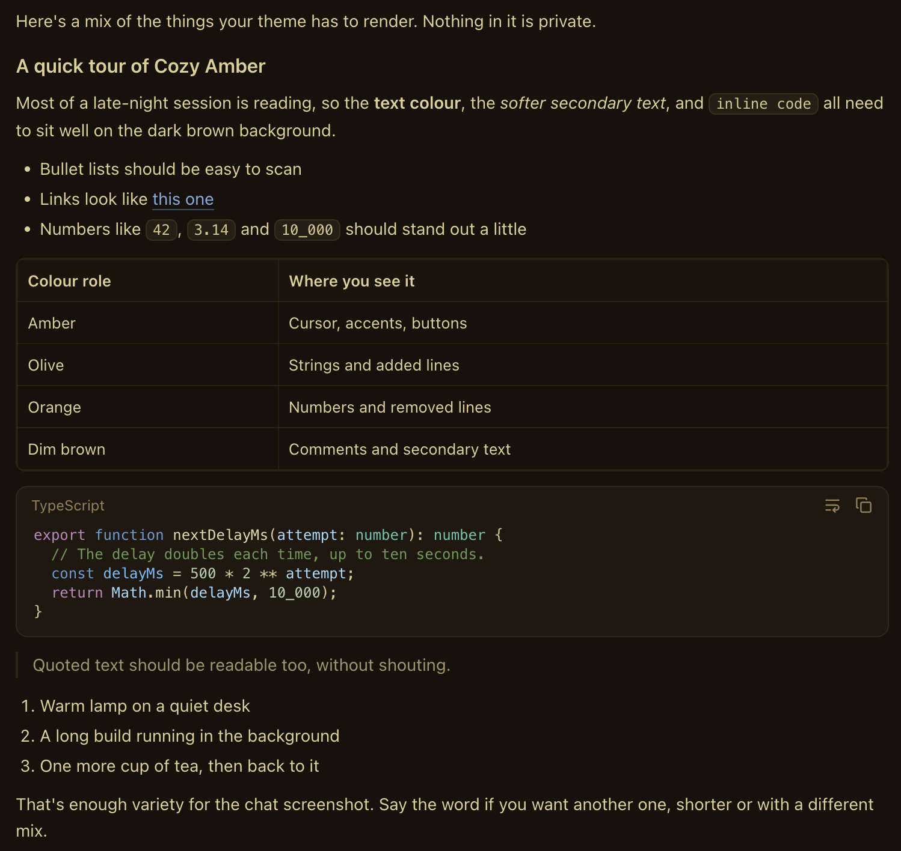
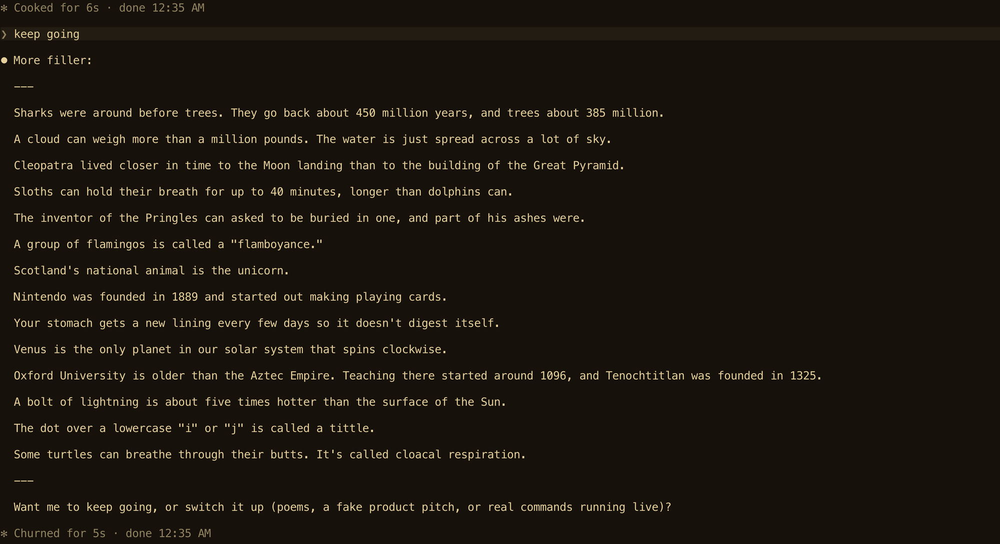
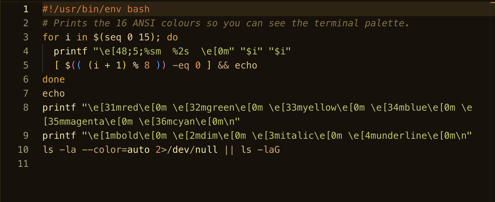
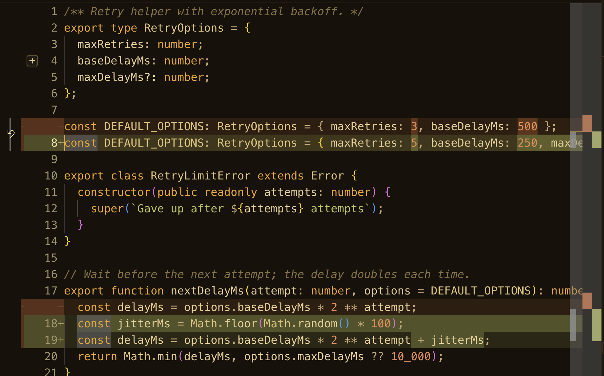

# Cozy Amber for Orca

A warm amber-on-brown dark theme for Orca: UI, terminal, editor and diff colours.

Choose it under Settings → Appearance; its terminal colours are offered alongside it.

Made by Mohammed Alamgir. Inspired by Cathode Amber in Rex by Superlogical.

## Screenshots

### Chat

### Terminal

### Editor

### Diff

